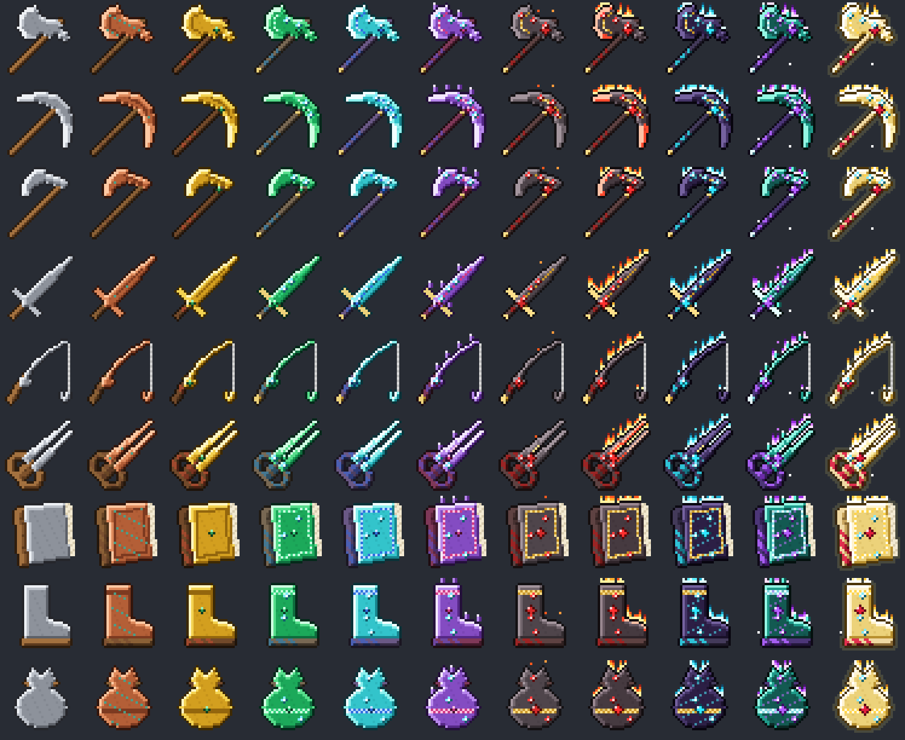

# Métiers : datapack et resource pack

Datapack vanilla de métiers (Bûcheron, Fermier, Mineur, Chasseur, Pêcheur, Éleveur, Enchanteur, Explorateur, Marchand) pour notre serveur, avec niveaux jusqu'à 100, arbres de compétences, outils qui évoluent, défis du jour, classement, prestige, heure du métier et boss de serveur.



## Contenu

| Fichier | Rôle |
|---|---|
| `metiers.zip` | Datapack, à mettre dans `world/datapacks/` |
| `metiers_resourcepack.zip` | Resource pack des outils (textures 32x32 animées) |
| `sources/textures.py` | Générateur des textures |
| `sources/datapack.py` | Générateur du datapack |

## Installation sur le serveur

Dans `server.properties` :

```
resource-pack=https://github.com/Katjounis/minecraft-metiers/raw/main/metiers_resourcepack.zip
resource-pack-sha1=ac917ae35dc67c5ee11cef20608b3c1bdff251d5
require-resource-pack=true
```

Le SHA-1 doit être recalculé à chaque nouvelle version du resource pack.

## En jeu

Touche G (ou menu Échap) pour ouvrir le menu des métiers, ou `/trigger metiers`.

Commandes admin : `/function metiers:boss/invoquer`, `/function metiers:heure/lancer`, `/function metiers:defis/nouveaux`.
